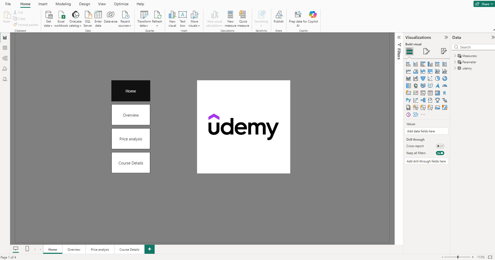
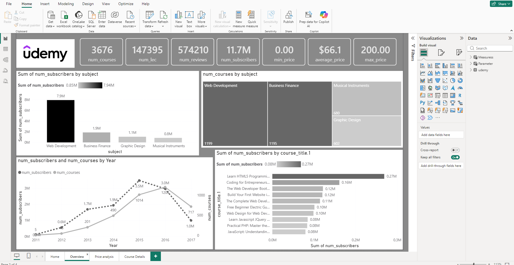
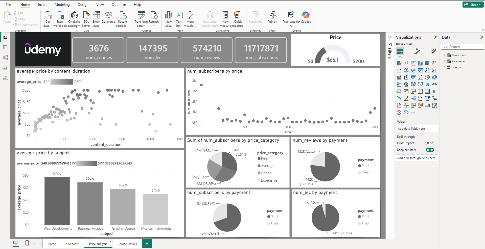

# Udemy Courses Analysis (Power BI)

A multi-page interactive Power BI report analyzing Udemy courses: subscribers, pricing, reviews, and content, to understand which subjects and pricing strategies attract the most learners.

## Business Questions
- Which subjects have the most courses and the most subscribers?
- How does price relate to course length and popularity?
- Do free courses attract more learners than paid ones, and how do reviews and content volume compare?
- How did the number of courses and subscribers change over the years?

## Dataset
- **Source:** Public Udemy courses dataset (add the link here)
- **Size:** 3,676 courses across 4 subjects (Web Development, Business Finance, Graphic Design, Musical Instruments)
- **Main fields:** subject, course title, level, payment (Free/Paid), price, price category, number of lectures, content duration, number of reviews, number of subscribers, year

## Tools
Power BI Desktop: Power Query (data cleaning), DAX measures, interactive visuals, slicers, page navigation buttons

## Report Pages

### 1. Home
Landing page with navigation buttons to every page of the report.

### 2. Overview

KPI cards (courses, lectures, reviews, subscribers, min/average/max price), subscribers by subject, courses by subject (treemap), subscribers and courses by year, and the top courses by subscribers.

### 3. Price Analysis

Average price vs content duration, subscribers by price, average price by subject, and Free vs Paid splits for subscribers, reviews, and lectures.

### 4. Course Details

A detailed course table (subject, title, level, payment, lectures, subscribers) with slicers to filter by payment type and level.

## Key Insights

| KPI | Value |
|-----|-------|
| Total Courses | **3,676** |
| Total Lectures | **147,395** |
| Total Reviews | **574,210** |
| Total Subscribers | **11.7M** |
| Average Price | **$66.1** (max $200) |

1. **Web Development dominates:** it has the most courses (1,199) and the most subscribers (7.9M, about 67% of all subscribers), far ahead of Business Finance (1.9M), Graphic Design (1.1M), and Musical Instruments (0.8M).
2. **Free courses attract learners but paid courses bring more engagement overall:** about 69% of subscribers are in paid courses (8M vs 4M in free), and paid courses hold 77% of reviews and 95.5% of lectures.
3. **Pricing differs by subject:** Web Development has the highest average price ($77.0), then Business Finance ($68.6), Graphic Design ($57.9), and Musical Instruments ($49.6).
4. **Longer content supports higher prices:** average price rises with content duration, then flattens out for very long courses.
5. **Popularity is not driven by price:** subscribers by price shows the biggest enrollments at the free end ($0) and a few at the top price points, while most price levels have relatively low enrollment.
6. **The most popular course** is a free-beginner style web course (Learn HTML5 Programming) with about 0.27M subscribers.

## Recommendations
- Prioritize new courses in **Web Development**, where demand is highest.
- Use **free courses** as an entry point to grow the audience and convert learners to paid courses.
- Price courses in line with their **content duration** and subject.
- Review under-served subjects (Musical Instruments, Graphic Design) for growth opportunities.

## Files
- `udemy.pbix`: the Power BI report
- `Home.PNG`, `overview.PNG`, `price_analysis.PNG`, `course_details.PNG`: report screenshots
